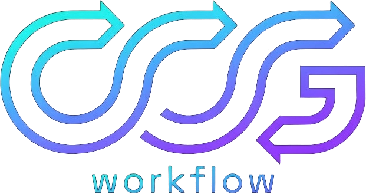
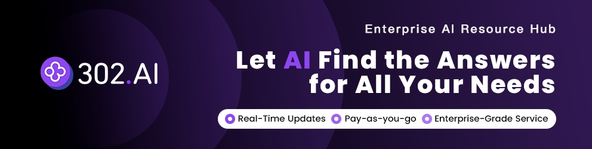

> **个人版 Codex 专用候选。** 此构建使用独立包 `@jed-zed/ccg-codex-workflow` 和命令 `ccg-codex`。先阅读 [HOST_ISOLATION.md](./HOST_ISOLATION.md)。Claude 保留原作者 CCG，只增独立 `plugins/ccg-gptpro-bridge`。下方旧 Claude 初始化示例保留历史出处，此构建不提供这些入口。

# CCG - Claude + Codex + Gemini 多模型协作

<div align="center">



[](https://github.com/jed-zed/ccg-gptpro-worflow)
[](https://opensource.org/licenses/MIT)
[](https://github.com/jed-zed/ccg-gptpro-worflow/actions/workflows/ci.yml)
[](https://claude.ai/code)
[](https://nodejs.org/)
[](https://deepwiki.com/fengshao1227/ccg-workflow)

[简体中文](./README.zh-CN.md) | [English](./README.md)

</div>

> 这是 `jed-zed` 的个人发行版，由
> [`trellis-ccg-harness`](https://github.com/jed-zed/trellis-ccg-harness)
> 管理。项目保留上游署名，但以个人仓库、固定来源清单和 Harness
> 事务式更新器为唯一权威来源。

<a id="mcpx-setup"></a>

## 网页通过 MCPX 读写代码：安装与配置教程

**启用 MCPX 模式前，必须先安装 MCPX、登记工作区，并在网页端配置可用的 MCPX 连接器。** CCG 不会替你安装服务、创建认证或开启隧道。网页使用 MCPX 读取输入、写入指定文件并执行指定测试；Codex 独立审核代码、检查工具证据并进行本地验证。默认 `read-write-execute` 是新任务的有界范围约定，仍须用户明确授权、精确文件与命令；它不授权任意操作。

如果只需要网页返回完整代码块，再由 Codex 审核和落盘，显式选择 `summary` 即可，**无需安装 MCPX**。这种模式必须标注“网页未直接读取工作区”。不要把连接失败自动降级成 summary，或把模型自述当成访问证明。

### 1. 固定版本并安装

这里的 MCPX 是官方 [opentokenz/mcpx](https://github.com/opentokenz/mcpx)。本教程按实际验收的 [v0.9.18](https://github.com/opentokenz/mcpx/releases/tag/v0.9.18) 编写，源码固定为 [`d17e68a`](https://github.com/opentokenz/mcpx/tree/d17e68a59bbe63aa94bfec595957180422ca242f)。2026-10-20 查询时最新发布为 v0.9.19；本次验收没有覆盖它。不要混用其他同名 MCPX 项目。

Windows AMD64 示例；所有目录、域名、工作区名及 ID 都是占位值，请改为自己的值。已有 MCPX 的用户先核对版本和现有连接，复用已支持的路径，勿覆盖正在运行的服务。

```powershell
$releaseRoot = 'https://github.com/opentokenz/mcpx/releases/download/v0.9.18'
$archivePath = Join-Path $env:TEMP 'mcpx_0.9.18_windows_amd64.zip'
Invoke-WebRequest "$releaseRoot/mcpx_0.9.18_windows_amd64.zip" -OutFile $archivePath
Invoke-WebRequest "$releaseRoot/checksums.txt" -OutFile "$archivePath.checksums.txt"
Get-FileHash -LiteralPath $archivePath -Algorithm SHA256
Get-Content -LiteralPath "$archivePath.checksums.txt"
# 核对清单中该 ZIP 的 SHA256 完全一致，再解压到新的版本目录。
Expand-Archive -LiteralPath $archivePath -DestinationPath 'D:\Tools\MCPX\0.9.18'
$mcpxExe = 'D:\Tools\MCPX\0.9.18\mcpx.exe'
& $mcpxExe -version
& $mcpxExe -h
```

macOS/Linux 请从同一 release 选择正确 CPU 的压缩包并验证摘要。源码构建需要 Go 1.26.1 或更新版本：固定上述 commit 后运行 `go build -o bin/mcpx ./cmd/mcpx-server`。参见[官方快速开始](https://github.com/opentokenz/mcpx/blob/d17e68a59bbe63aa94bfec595957180422ca242f/README.md#L111)。本节命令供用户配置时执行；CCG 的 configure/prepare 不会启动 MCPX。

### 2. 配置文件、目录与安全策略

默认全局配置是 `~/.mcpx/config.yaml`。`MCPX_HOME` 可更换其根目录；在同一 PowerShell 进程内设置，注册和启动命令都必须使用同一目录。新建独立实例可用：

```powershell
$env:MCPX_HOME = 'D:\MCPXData\ccg-demo'
New-Item -ItemType Directory -Path $env:MCPX_HOME -Force | Out-Null
# 在该目录创建 config.yaml，填入下面的真实字段并替换占位值。
```

已有配置先在本机备份。不要把含口令的文件、备份、OAuth 数据、SQLite 状态或原始会话提交 Git。以下配置先使用本机监听；OAuth 口令需自行生成并仅在本机填写。`server_url` 是准备提供给连接器的公开 HTTPS Origin，不带 `/mcp`。

```yaml
server:
  host: 127.0.0.1
  port: 9090
  disable_localhost_protection: false
  trust_proxy_headers: false
auth:
  mode: oauth
  oauth:
    password: "<仅在本机填写的强随机口令>"
    server_url: "https://mcp.example.com"
    token_ttl: 86400
security:
  commands:
    default: confirm
    auto_allow_readonly: false
  files:
    allow:
      - '^demo/'
    deny:
      - '(^|/)\.git(/|$)'
      - '(^|/)\.env($|\.)'
      - '(^|/)(\.ssh|\.aws|\.codex)(/|$)'
      - '(^|/)(auth\.json|credentials\.json|id_rsa)$'
      - '(?i)\.(pem|key)$'
workspaces:
  - name: ccg-demo
    path: 'D:\Projects\ccg-demo'
    description: "仅供明确授权的 CCG 演示任务"
```

这个示例只允许工作区内 `demo/` 下的普通文件；先自行创建 `demo/spec.md`，写入无敏感信息的任务说明。文件规则是正则表达式，路径使用 `/`，不是 glob。`deny` 优先；一旦配置了任一 allow/confirm/deny 列表，未匹配路径默认需确认，而源码 `read` 只接受 Allow，所以不能只写 deny 却期望其余源码都可读。根据任务收窄 allow，而非为省事放开整个磁盘。字段和行为见[配置 schema](https://github.com/opentokenz/mcpx/blob/d17e68a59bbe63aa94bfec595957180422ca242f/internal/config/config.go#L20)及[规则实现](https://github.com/opentokenz/mcpx/blob/d17e68a59bbe63aa94bfec595957180422ca242f/internal/security/commands.go#L500)。

项目 `.mcpx.yaml` 可以覆盖安全策略；审查它，不能宣称全局 deny 是项目无法削弱的 ACL。文件规则也不是执行进程的操作系统沙箱；命令仍具有 MCPX 进程的 OS 权限。只登记最小可信目录，不登记用户主目录、凭据目录或含私人项目的父目录。v0.9.18 的 `workspaces` 条目只有 `name/path/description`，不要编造 `read_only` 字段。

### 3. 登记工作区并加载

也可以用官方 CLI 登记现有目录：

```powershell
& $mcpxExe workspace register 'D:\Projects\ccg-demo'
```

此命令写全局 `config.yaml`，不启动服务，默认名称取目录 basename；核对同名条目，防止更新了另一条登记。显式填写上面的 YAML 可控制名称。检查完配置后，新实例可运行：

```powershell
& $mcpxExe -d
```

**运行中的 Runtime 在启动时加载配置和工作区注册。** 改完配置/登记后先确认没有在途任务，再在维护窗口对该实例执行 `& $mcpxExe stop`、`& $mcpxExe -d`。它会影响该 `MCPX_HOME` 下的服务；不要对不属于自己的共享实例盲目重启。没有 `mcpx reload` 或 `mcpx workspace list` 命令，Desktop 的刷新列表也不等于 Runtime 重载。随后刷新连接器工具，必要时建立新的客户端会话，再用模型侧 `workspace()` 核对名称和路径。[注册实现](https://github.com/opentokenz/mcpx/blob/d17e68a59bbe63aa94bfec595957180422ca242f/internal/config/load.go#L285)、[Runtime 加载](https://github.com/opentokenz/mcpx/blob/d17e68a59bbe63aa94bfec595957180422ca242f/internal/server/runtime.go#L149)。

### 4. 连接器与已支持的 HTTPS 路径

MCPX 仅提供 Streamable HTTP `/mcp`，不提供旧 `/sse`。远程 ChatGPT 连接器需要能访问 `https://mcp.example.com/mcp`，不能把远程服务指向你电脑的 `127.0.0.1`。优先复用现有已授权的连接器和隧道；隧道并不代替 OAuth。

官方已有的方案如下，按实际环境选一种并完整遵循官方步骤：

- Windows：`& $mcpxExe desktop`，在 Cloudflare 页面使用已配置 hostname 的 Named Tunnel；Quick Tunnel 域名临时变化，不适合稳定的 OAuth 连接器。Desktop 内置集成会检查认证、调整自己的 MCPX Host/proxy 配置并同步 OAuth Origin。参见[官方 Desktop/Cloudflare 说明](https://github.com/opentokenz/mcpx/blob/d17e68a59bbe63aa94bfec595957180422ca242f/README.md#L748)。
- [FRP + Caddy 原生部署](https://github.com/opentokenz/mcpx/blob/d17e68a59bbe63aa94bfec595957180422ca242f/docs/frp-caddy-native.md)：在受信反代场景，按该文配置 `disable_localhost_protection`、`trust_proxy_headers`、TLS 与 OAuth Origin；这两个开关不能对不可信代理随意启用。
- [FRP + Caddy Docker Compose](https://github.com/opentokenz/mcpx/blob/d17e68a59bbe63aa94bfec595957180422ca242f/docs/frp-caddy-docker-compose.md)：仅将代理容器化，MCPX 原生运行以访问本地项目。

公网不要使用 `auth.mode: open`。域名、证书、代理、OAuth 配置必须一致。CCG 不会自动搭建上述设施，也不把创建隧道或变更认证视为普通代码任务的一部分。

在有资格使用该功能的 ChatGPT 账号中启用 Developer Mode，进入 Apps 创建自定义 App，填写 `/mcp` URL、选择 OAuth，由用户在官方授权页面完成登录/授权，再 Scan Tools。界面名称和账号可用性可能变化，以[官方连接器教程](https://github.com/opentokenz/mcpx/blob/d17e68a59bbe63aa94bfec595957180422ca242f/docs/frp-caddy-native.md#L658)及当前界面为准。已有 App 先刷新，不复制本机 token/session，也不自动操作认证。MCPX 的 `oauth-register` 用于官方教程所述的特定 OAuth 客户端注册链接；不要随意填写或猜测回调 URL。

### 5. 验证连接，再建立 CCG 有界范围

依次检查：`-version` → MCP `initialize` → `tools/list` → `workspace()` → 打开指定工作区的 Remote Session → `runtime_read(view="capabilities")` → `read` 专用 `demo/spec.md`。以工具实际返回的完整 workspace/session ID、role、能力、revision/hash 为准；裸 GET `/mcp`、模型声称“已读”或本地 Codex 的文件读取都不能替代网页 MCPX 证据。

CCG 控制端应从成功的现有 MCPX 工具结果生成私有 preflight JSON，真实字段为：`schemaVersion: 1`、`source: successful-existing-MCPX-tools`、`observedAtUtc`、`runtime.version`、`workspace.{name,path}`、`remoteSession.{id,status,role}`、`availableTools`、`sourceFiles`（每项 `path` 与 `revision` 或 `sha256`）。它不是要手工伪造的成功回执；configure 本身不会证明连接。prepare 时该回执必须在 5 分钟内，所有输入均已有成功读取和版本记录。

有界 scope 文件示例（这是 **CCG JSON**，不是 MCPX YAML）：

```json
{
  "workspaceId": "ccg-demo",
  "remoteSessionId": "<现有工具返回的完整 ID>",
  "browserProfileId": "<已批准浏览器绑定返回的 profile ID>",
  "entrypoint": "demo/spec.md",
  "allowedPaths": ["demo/spec.md"],
  "authorizationConfirmed": true,
  "taskDirectory": "demo",
  "writePaths": ["demo/example.py", "demo/test_example.py"],
  "allowedExecutions": [
    {"argv": ["python", "-m", "unittest", "discover", "-s", "demo", "-v"], "shell": false}
  ]
}
```

只有用户确已授权该目标、这些输出和命令后才能写 `authorizationConfirmed: true`。省略 `permissionMode` 对新 scope 默认 `read-write-execute`；仅分析任务应明确写 `"permissionMode": "read-only"`，并移除写入和执行字段。输入与输出都须在 `taskDirectory` 下。执行工作目录固定为已登记工作区根目录，不能把 argv 悄悄改成 shell/script/task 方式。生产权限需真实 owner/editor 角色及 workspace/session/runtime_read/read/edit/execute/observe/progress 能力，CCG 不会提高服务端权限。

从此源码 checkout 先解析 helper 的绝对路径，然后切到已登记的实际项目根目录运行；安装后请从同一个完整插件根目录解析脚本，勿混用缓存版本。`--workdir`、job 输入、scope/preflight 和任务账本必须对应同一项目：

```powershell
$bridgeScripts = Join-Path (Get-Location) 'plugins\ccg\skills\ccg-gptpro-bridge\scripts'
$budget = Join-Path $bridgeScripts 'gptpro_budget.py'
$workspaceRoot = 'D:\Projects\ccg-demo'
Set-Location -LiteralPath $workspaceRoot
$stateFile = '.ccg/tasks/demo/advice-budget.json'
python $budget configure --state $stateFile --mode save-codex `
  --codex-thread-id '<当前真实 thread UUID>' --evidence-access mcpx `
  --mcpx-scope-file '.private/demo-scope.json' `
  --mcpx-preflight-file '.private/demo-preflight.json'
python $budget prepare --state $stateFile --workdir $workspaceRoot `
  --job-file '.private/demo-job.json' --context-file '.private/demo-context.md' `
  --thinking-mode Pro
```

`job` JSON 必须包含 `importance`（`step` 或 `critical`）和 `risk`（`low` 或 `high`），并提供非空 `goal`、`snapshot`。使用下面完整的 `.private/demo-job.json` 示例；`inputs` 是相对 `--workdir` 的实际输入，`complexity` 可选：

```json
{
  "importance": "step",
  "risk": "low",
  "complexity": 2,
  "goal": "按 demo/spec.md 生成 example.py 和 test_example.py",
  "snapshot": "demo-spec-v1",
  "acceptance": "实现符合说明，指定 unittest 命令退出码为 0",
  "inputs": ["demo/spec.md"]
}
```

`.private/demo-context.md` 可只写“读取已授权 demo/spec.md，按约定生成完整实现和测试”。先将 `.private/` 加入本机 Git 排除规则（例如 `.git/info/exclude`），不要提交真实 preflight/scope/session 回执。上下文只放目标和取证提示，源码由已授权 MCPX 路径获取。Trellis 任务将 state 放在已有任务的 `.ccg-evidence/` 中，不创建第二个任务。

configure/prepare **不发送网页请求**。首次 prepare 返回能力检查请求，只读 entrypoint；按[桥接 Skill](./plugins/ccg/skills/ccg-gptpro-bridge/SKILL.md)绑定原请求、使用既有 RootWait 流程，验证能力后再 prepare 生产请求。两者都使用自己原始的请求身份，不得把未确定结果换目录重发。本次源码配套 sidebar 基线仅支持 Pro，因此示例明确指定 `Pro`。其他网页强度需要另行具备该能力的 sidebar，且按 profile/workspace/强度分别验证；不支持时保持阻塞，不静默切换。

### 6. 执行确认、证据与验收

若 MCPX 返回 `waiting_confirmation`，向用户展示实际命令、工作目录和用途，等待对该动作的明确确认。然后遵循工具返回的 action，保留原始业务参数、`idempotency_key`、精确 argv 和 `shell=false`，用 `user_confirmed=true` 续轮；不要使用已废弃的 `approval_manage`。确认只涵盖原命令，不允许扩展写入、开启隧道或操作其他目录。[实际 execute 确认实现](https://github.com/opentokenz/mcpx/blob/d17e68a59bbe63aa94bfec595957180422ca242f/internal/server/tools_command_execute.go#L133)。

CCG `record` 要求正常导入的网页回复、独立获取且完整分页的 MCPX structured history，以及重新读取输入版本的 current receipt。执行确认续轮还需 `--mcpx-confirmation-dir` 指向已完成的原始 RootWait 证据；保留原请求标记、浏览器/会话、原 argv 和绝对截止时间。等待确认不是执行成功，最终仍需同一命令的成功事件、正确工作目录和数值退出码 `0`。历史失败保存在 `resultHistory`；两个证据时间窗之间的活动不能拿来补齐证明。

代码提取必须读取属于该助手回复的完整 CodeMirror 文档，不能拼接虚拟化可见行充当完整代码。已完成回复的重提取使用 `reextract`，写入独立 sibling receipt，保留原始证据及时间戳。Codex 仍须独立审阅最终代码并本地复测；网页测试成功或导入成功不能直接代表验收。

### 7. 常见故障与回退

| 现象 | 检查与处理 |
|---|---|
| 看不到新登记目录 | 核对 MCPX_HOME、config.yaml 和路径；确认无在途任务后重启对应 Runtime，再刷新工具/客户端会话 |
| 401 / OAuth 循环 | 核对 OAuth Origin、issuer/resource 与公开域名；由用户重新完成官方授权，不拷贝 token |
| 404 / SSE 错误 | 使用 Streamable HTTP 的 `/mcp`，不是 `/sse`，检查反代路由 |
| `read` 被拒绝 | 核对正则 allow/deny 与 `.mcpx.yaml`；仅有 deny 时普通文件也可能没有 Allow |
| `MCPX_PREFLIGHT_STALE...` | 重新用现有只读工具取真实回执；不手改时间戳 |
| `MODE_TOOLS_UNAVAILABLE` / `mcpx-blocked` | 检查真实能力、角色、profile、scope；保持阻塞，不自动升权、换强度或降级 |
| `awaiting-mcpx-proof` | 补齐独立历史分页、每个输入的精确 read 路径、版本和最终 edit/execute 证据 |
| 两个可见输入框 / 不完整代码文档 | 保持歧义或提取失败状态；隐藏布局副本可被唯一定位，两个可编辑可见节点不能取第一个 |
| 发送结果不确定 | 保留原 evidence/idempotency 身份，仅观察与恢复；不换目录重发 |

CCG 无 MCPX 回退必须由用户显式选择：

```powershell
python $budget configure --state $stateFile --mode save-codex --evidence-access summary
python $budget prepare --state $stateFile --workdir $workspaceRoot `
  --job-file '.private/demo-job.json' --context-file '.private/demo-summary.md' `
  --thinking-mode Pro
```

summary 可请求完整实现和测试代码块，无需 MCPX。Codex 审核后落盘并本地测试，注明网页仅收到摘要。`configure --mode standard` 关闭可选分配但保留原账本。MCPX 二进制/配置回退则在无在途任务的维护窗口恢复本机保留的旧版本与备份；保留已有认证，不自动删除会话或重建隧道。官方[验证与排障](https://github.com/opentokenz/mcpx/blob/d17e68a59bbe63aa94bfec595957180422ca242f/README.md#L415)可辅助检查；该版本英文 README 含旧工具名，字段和确认协议以中文 README 与实际 Go 实现为准。


## ♥️ Sponsor

[](https://gammaremover.com/)

[Gamma Remover](https://gammaremover.com/) — 免费浏览器本地 Gamma 水印去除工具。支持 PDF 和 PPTX，无需注册，即时出结果，100% 隐私，文件不离开你的设备。

---

[](https://share.302.ai/oUDqQ6)

[302.AI](https://share.302.ai/oUDqQ6) is a pay-as-you-go enterprise AI resource hub that offers the latest and most comprehensive AI models and APIs on the market, along with a variety of ready-to-use online AI applications.

---

## CCG 是什么？

**CCG 是 Claude Code 的工作流引擎。** 它让 Claude 变成多模型编排器 —— Claude 保持主控地位，通过 Go 编译的 codeagent-wrapper 将专业任务分发给 Codex（OpenAI）、Gemini（Google）和 Grok（xAI）。

此仓库的个人 Codex 包使用独立的 `ccg-codex` 命令。请按照
[HOST_ISOLATION.md](./HOST_ISOLATION.md) 使用已审核的本地 wrapper 文件安装。
原版 Claude CCG 的安装与此包分开。

## 架构

<div align="center">

</div>

**Claude Code** 是主控编排器。它分析你的意图、选择策略、管理整个工作流。**Hook 引擎**每轮注入状态，确保 Claude 永不丢失上下文 —— 即使上下文被压缩。**codeagent-wrapper**（编译的 Go 二进制）作为桥梁，将 Claude 连接到外部模型进行并行分析和审查。

## MCP 调研与旧 Grok 链路

积极搜索类似项目、可复用代码、已有方案与适用论文。按独立问题派发现有 `web_search` 子代理，以 grok-search MCP 为主要取资料工具，由 Codex 综合；保留原有代理模型与推理级别。

日常只做必要核验：关键结论对应原文；实际复用代码查版本和许可证；采用论文结论查实验条件；未核实的明确标注。不要求再并跑 Grok CLI/ACP，不强制 manifest、哈希证据包或等待旧搜索门禁。

使用已有 `codex` 搜索路由表达 Codex 编排，并保持 `intelligence.auto_route = false`。MCP 是取资料工具，不是新增 Provider；失败如实报告，不自动改走旧 CLI。

Grok 编码后端不变。显式 `/ccg:grok-intel`、`/ccg:grok-verify` 的旧实现和严格校验继续保留，普通工作流不自动调用。下方旧说明作为停用参考保留。

<!-- Legacy research instructions; inactive in ordinary MCP research.
## Grok 外部情报层

Grok 现在有两个刻意隔离的定位：

- **通用编码后端**：`--backend grok` 与其他模型后端一样，可通过 `codeagent-wrapper` 起草或审查代码。
- **外部情报层**：官方 Grok Build CLI 在短生命周期、只读的 ACP 会话中收集最新 Web 证据和有来源的 X 域证据。Codex 自主判断何时启用，并始终保留最终规划、编辑和验收权。

外部情报必须明确选择加入。`ccg init --intelligence` 只记录同意，不登录、不发送付费 prompt；`--no-intelligence` 会保持关闭。选择加入前请知悉：CCG 可能向 xAI 发送经过筛选的任务文件、锁文件、计划/diff 摘要和查询文本。秘密、凭据、`.git`、依赖目录、缓存、链接/重解析逃逸路径及 `.ccgignore` 路径会被排除。模型与搜索调用可能消耗账户额度或产生 API 费用。

```bash
ccg grok login                  # 在独立私有 GROK_HOME 中进行官方浏览器 OAuth
ccg doctor --grok               # 仅本地检查，不发送模型 prompt
ccg doctor --grok-live          # 显式、有限额的付费 Web/X 冒烟

/ccg:grok-intel <任务> --mode discover|contract|incident|landscape
/ccg:grok-verify [计划或 diff]
```

自动路由覆盖规划、执行、审查、Team、Spec、GPT Pro，以及涉及外部事实的质量门禁。API/SDK、依赖升级、线上事故、CVE、云/数据库版本、法规和弃用属于硬触发；Codex 也可给出带理由的语义判断。本地重构和纯 Git 工具默认不联网。任务阶段、计划、目标、依赖或 diff 摘要变化时会重新判断。必需门禁失败会关闭式阻断，不会回退到旧 `grok-search` MCP 或其他提供方。

`x_search_policy` 可设为 `required`、`preferred`、`disabled`。事故模式可把 `preferred` 提升为必需；`disabled` 永不提升，且仅来自 X 的材料只能作为发现线索，不能独立形成阻塞结论。当前 Grok ACP 还可能发出不含来源 URL 的原生 `XSearch` 事件：CCG 只把它记录为发现型建议，真正有来源的 X 证据必须来自相关联的 `WebSearch site:x.com/site:twitter.com` 结果。Deep research 默认关闭；未来即使启用，也只是 leader 可见的建议证据，不能单独满足必需门禁。

验证后的证据默认只保存在本地：

```text
.codex/ccg/intelligence/<evidence-id>/
├── manifest.json
├── evidence.json        # 机器可读的事实源
├── report.md
└── raw-stream.jsonl     # 已脱敏审计流

.ccg/tasks/<task-id>/
├── evidence.json        # 规范化、有限大小的任务证据项
└── task.json            # intelligence 指针与哈希
```

缓存键绑定任务、模式、计划、目标、依赖、diff 和阶段；`--force-refresh` 可跳过缓存。本地证据默认保留 7 天，显式导出的脱敏包保留 30 天。只有传入 `--export <目录>` 才会导出，系统绝不自动导出。必需门禁只能由用户明确授权豁免，并记录理由和时间。

Windows 上的凭据目录和运行目录使用仅所有者 ACL，并拒绝 junction/重解析路径穿越。桌面默认使用浏览器 OAuth；手动 GitHub Actions live smoke 通过受 environment 审批的 `XAI_API_KEY` 运行。若 Windows 运行器没有创建链接的权限，junction 测试会被系统跳过，但生产路径一旦观察到链接或重解析点仍会关闭式拒绝。
-->

## 工作流程

```
你: /ccg:go 给这个 API 加 JWT 认证

CCG 引擎:
  1. 读取项目上下文（git 状态、技术栈、文件结构）
  2. 分类：功能 / L 复杂度 / 后端 / 高风险
  3. 选择策略：full-collaborate（全协作）
  4. 创建 .ccg/tasks/add-jwt-auth/task.json
  5. 启动双模型并行分析（Codex + Gemini）
  6. 生成计划 → 硬停等你审批
  7. 派生 Agent Teams Builder 并行实施
  8. 运行质量关卡 + 双模型交叉审查
  9. 报告结果

每一轮，Hook 自动注入：
  <ccg-state>
  任务: add-jwt-auth (进行中)
  策略: full-collaborate
  阶段: 4-实施
  </ccg-state>
```

## 10 种内置策略

引擎根据任务类型和复杂度自动选择最佳策略：

| 策略 | 适用场景 | 外部模型 | Agent Teams |
|------|---------|:---:|:---:|
| `direct-fix` | 简单 bug，单文件 | — | — |
| `quick-implement` | 小功能，范围明确 | — | — |
| `guided-develop` | 中等功能，需要规划 | 单模型 | — |
| `full-collaborate` | 复杂功能，跨模块 | 双模型并行 | ✓ |
| `debug-investigate` | 复杂 bug，原因未知 | 双模型诊断 | — |
| `refactor-safely` | 代码重构 | 双模型审查 | — |
| `deep-research` | 技术调研 | 双模型探索 | — |
| `optimize-measure` | 性能优化 | 可选 | — |
| `review-audit` | 代码审查 | 双模型交叉审查 | — |
| `git-action` | commit、rollback、分支 | — | — |

简单任务零开销快速执行。复杂任务调动全部引擎能力。

## 核心能力

### Hook 引擎 — 永不丢失上下文

4 个 JavaScript Hook 为每个 Claude Code 会话注入状态：

| Hook | 触发时机 | 作用 |
|------|---------|------|
| `workflow-state.js` | 每轮用户消息 | 注入当前任务状态面包屑 |
| `session-start.js` | 会话开始/压缩 | 重新注入完整项目上下文 |
| `subagent-context.js` | Agent/Bash 调用 | 将 spec 直接注入子 agent 的 prompt |
| `skill-router.js` | 每轮用户消息 | 按关键词自动注入域知识 |

上下文在压缩后自动恢复。子 agent 出生即带 spec。零状态丢失。

### 任务系统 — 持久化生命周期

中等及以上复杂度的任务获得持久化目录：

```
.ccg/tasks/add-jwt-auth/
├── task.json         # 状态、策略、阶段、门控
├── requirements.md   # 增强需求
├── plan.md           # 已审批的实施计划
├── context.jsonl     # 子 agent 注入的 spec 文件
├── review.md         # 审查结果
└── research/         # 持久化研究成果
```

### 质量关卡 — 内置安全与质量检查

| 关卡 | 触发条件 |
|------|---------|
| `/ccg:verify-security` | 新模块、安全相关变更 |
| `/ccg:verify-quality` | 变更超过 30 行 |
| `/ccg:verify-change` | 文档同步检查 |
| `/ccg:verify-module` | 模块结构检查 |
| `/ccg:gen-docs` | 自动生成 README + DESIGN |

### 100+ 域知识秘典

当你的消息提到安全、缓存、RAG、Kubernetes 等关键词时，对应的知识文件自动注入。10 大领域，61 个文件：

`安全` · `架构` · `DevOps` · `AI/MLOps` · `开发语言` · `前端设计` · `基础设施` · `移动端` · `数据工程` · `编排`

## 命令

### 核心命令（v3.3 默认安装 17 个）

| 命令 | 说明 |
|------|------|
| `/ccg:go` | **智能入口** — 描述你要做什么，引擎自动处理 |
| `/ccg:commit` | 智能 Conventional Commit |
| `/ccg:rollback` | 交互式回滚 |
| `/ccg:clean-branches` | 清理已合并分支 |
| `/ccg:worktree` | Worktree 管理 |
| `/ccg:init` | 初始化项目 CLAUDE.md |
| `/ccg:context` | 项目上下文管理 |

### 外部证据命令

| 命令 | 说明 |
|------|------|
| `/ccg:grok-intel` | 显式调用的旧 ACP 情报链路，普通调研不依赖 |
| `/ccg:grok-verify` | 显式调用的旧核验链路，不作为自动最终门禁 |
| `/ccg:gptpro-plan` | 自动 GPT Pro 侧栏规划证据，可使用已有 MCP 调研 |
| `/ccg:gptpro-exc` | 自动 GPT Pro 侧栏执行路线审查 |
| `/ccg:gptpro-review` | 自动 GPT Pro 侧栏审查，按需加入来源发现 |

<!-- Legacy research instructions; inactive in ordinary MCP research.
| `/ccg:grok-intel` | 通过隔离的 Grok ACP 收集并验证最新 Web/X 证据 |
| `/ccg:grok-verify` | 根据最新事实核验计划、diff、目标和依赖 |
| `/ccg:gptpro-plan` | 必需 Grok 路由后，手动获取 GPT Pro 规划证据 |
| `/ccg:gptpro-exc` | 手动进行 GPT Pro 执行路线审查 |
| `/ccg:gptpro-review` | 使用规范 Grok 来源记录进行 GPT Pro 最终审查 |
-->

### OpenSpec 集成

| 命令 | 说明 |
|------|------|
| `/ccg:spec-init` | 初始化 OPSX 环境 |
| `/ccg:spec-research` | 需求 → 约束集 |
| `/ccg:spec-plan` | 零决策可执行计划 |
| `/ccg:spec-impl` | 按规范实施 + 归档 |
| `/ccg:spec-review` | 双模型交叉审查 |

### Legacy 模式（额外 18 个命令）

包括 `/ccg:workflow`、`/ccg:plan`、`/ccg:execute`、`/ccg:frontend`、`/ccg:backend`、`/ccg:analyze`、`/ccg:debug`、`/ccg:optimize`、`/ccg:test`、`/ccg:review`、`/ccg:team` 等。

## 快速开始

从已审核的个人仓库 40 位完整 commit 开始，并准备已固定哈希的本地 wrapper 文件。
安装前先阅读 [HOST_ISOLATION.md](./HOST_ISOLATION.md)；如需保留现有代理的模型设置，
先生成并审核代理保留计划。在源代码目录中可先进行只读准备：

```bash
pnpm install --frozen-lockfile
pnpm build
node bin/ccg.mjs codex-mode --help
```

需要 **Node.js 20+**、pnpm 和 Codex CLI。安装会更改受管理的 Codex 路径，
应在审核计划和本地文件后执行。仓库链接本身不代表安装授权；交给 AI 代理时，
请让它遵循 [AI_INSTALL.md](./AI_INSTALL.md)。

## Codex CLI 命令

```bash
node bin/ccg.mjs                            # Codex 专用帮助
node bin/ccg.mjs addons --json              # 只读查看可选组件
node bin/ccg.mjs doctor                     # Codex 健康检查
node bin/ccg.mjs status                     # Codex 安装概况
node bin/ccg.mjs codex-mode --help          # 安装和保留计划参数
node bin/ccg.mjs codex-mode recover         # 恢复中断的事务
node bin/ccg.mjs codex-mode uninstall       # 只移除受管理的 Codex 文件
```

安装命令为 `node bin/ccg.mjs codex-mode install --wrapper-file "<已审核本地文件的绝对路径>"`；
代理保留计划和文件验证要求见 [HOST_ISOLATION.md](./HOST_ISOLATION.md)。

Codex 模式按能力矩阵设置四个角色：frontend/backend 支持 `codex`、
`gemini`、`claude`、`antigravity`、`grok`、`pi`；search 只支持 `codex`、
`grok`；product-manager 支持 `codex`、`gemini` 和 `claude`。CCG 工作流用
`ccg-codex wrapper` 托管 Claude/Antigravity/Grok/Pi；直接命令也接受普通
Codex/Gemini wrapper 后端，但不会修改角色路由。除非显式传入
`--lite`，否则默认打开浏览器网页。使用 frontend/backend 时还会自动加入
必需的 search 证据，并在下一适用检查点评估 product-manager 授权门；每次
Provider 调用仍需显式批准。Codex 仍负责真实工作区的最终写入和验证。

## 原版 Claude 配置（仅供历史参考）

```
~/.claude/
├── commands/ccg/          # 斜杠命令
├── hooks/ccg/             # Hook 脚本（5 个文件）
├── skills/ccg/            # 质量关卡 + 100+ 域知识
├── rules/                 # 自动触发规则
├── .ccg/
│   ├── config.toml        # 模型路由、MCP、性能配置
│   ├── engine/            # 10 个策略文件 + 模型路由器
│   └── prompts/           # 专家提示词（codex/gemini/claude）
└── bin/codeagent-wrapper  # 多模型桥接（Go 二进制）
```

### 环境变量

在 `~/.claude/settings.json` 的 `"env"` 中设置：

| 变量 | 默认值 | 说明 |
|------|--------|------|
| `CODEX_TIMEOUT` | `7200` | Wrapper 超时（秒） |
| `CODEAGENT_POST_MESSAGE_DELAY` | `5` | 完成后延迟（秒） |
| `CODEAGENT_RETAIN_LOG_ON_FAILURE` | 未设置 | 单次 Grok 诊断设为 `1`，失败后保留完整 wrapper 日志 |
| `ANTIGRAVITY_MODEL` | 未设置 | 作为 `--model` 传给 Antigravity；未设置或空白时保留 CLI 默认值 |
| `CLAUDE_CODE_EXPERIMENTAL_AGENT_TEAMS` | 未设置 | 设为 `1` 启用 Agent Teams 并行 |
| `XAI_API_KEY` | 未设置 | 经批准的无界面/CI Grok 情报运行所用显式 API Key |

## 安全与所有权

- Wrapper 二进制只从个人 Release 下载，并在 `chmod` 或执行前校验固定 SHA-256。
- 核心可执行 npm/Git 依赖仍以精确版本或完整 commit 记录在
  `third-party-sources.json`；五个可选 add-on 包使用明确的 `latest` 通道，
  仓库不再保存它们的数字版本。
- MCP 密钥放在仅所有者可读的文件中，由本地启动器加载，不进入进程参数，也不镜像到其他运行时。
- 官方远程 MCP 仅允许精确 HTTPS 地址，并分别使用 Claude 的 `type=http`、
  Codex 的 `url` 和 Gemini 的 `httpUrl`；拒绝 URL 凭据、任意 query 和旧版
  DeepWiki SSE。
- Exa 托管基础额度无需 Key；更高限额会引导到
  `https://dashboard.exa.ai/api-keys`，本地 Key 仍只进入所有者可读的
  secret launcher。
- Codex 模式使用摘要绑定的所有权清单和托管区块；安装、更新和卸载会保留无关用户文件，并对损坏配置或被修改的托管状态关闭式失败。
- `diagnose-mcp --smoke` 必须显式启用，仅支持 stdio，限制时间与输出，脱敏诊断并终止完整子进程树。

## 更新 / 回滚 / 卸载

内置公开 npm 更新器已禁用。在 `trellis-ccg-harness` 根目录使用个人仓库的完整 commit：

```bash
pnpm harness:update -- --ccg-commit <40-character-commit>
pnpm harness:doctor
pnpm harness:rollback
pnpm harness:uninstall
```

## 致谢

- [fengshao1227/ccg-workflow](https://github.com/fengshao1227/ccg-workflow) — CCG 上游项目
- [cexll/myclaude](https://github.com/cexll/myclaude) — codeagent-wrapper 灵感来源
- [UfoMiao/zcf](https://github.com/UfoMiao/zcf) — Git 工具参考
- [mindfold-ai/Trellis](https://github.com/mindfold-ai/Trellis) — Hook 状态注入模式
- [ace-tool](https://linux.do/t/topic/1344562) — MCP 代码检索

## 上游贡献者

<!-- readme: contributors -start -->
<table>
<tr>
    <td align="center"><a href="https://github.com/fengshao1227"><br /><sub><b>fengshao1227</b></sub></a></td>
    <td align="center"><a href="https://github.com/SXP-Simon"><br /><sub><b>SXP-Simon</b></sub></a></td>
    <td align="center"><a href="https://github.com/RebornQ"><br /><sub><b>RebornQ</b></sub></a></td>
    <td align="center"><a href="https://github.com/Sakuranda"><br /><sub><b>Sakuranda</b></sub></a></td>
    <td align="center"><a href="https://github.com/Mriris"><br /><sub><b>Mriris</b></sub></a></td>
    <td align="center"><a href="https://github.com/23q3"><br /><sub><b>23q3</b></sub></a></td>
    <td align="center"><a href="https://github.com/MrNine-666"><br /><sub><b>MrNine-666</b></sub></a></td>
</tr>
<tr>
    <td align="center"><a href="https://github.com/GGzili"><br /><sub><b>GGzili</b></sub></a></td>
</tr>
</table>
<!-- readme: contributors -end -->

## 支持

- **个人分支问题**: [GitHub Issues](https://github.com/jed-zed/ccg-gptpro-worflow/issues)
- **上游社区**: [Linux.do](https://linux.do)

## 许可证

MIT

---

v3.4.15 | [Issues](https://github.com/jed-zed/ccg-gptpro-worflow/issues) | [Contributing](./CONTRIBUTING.md)
